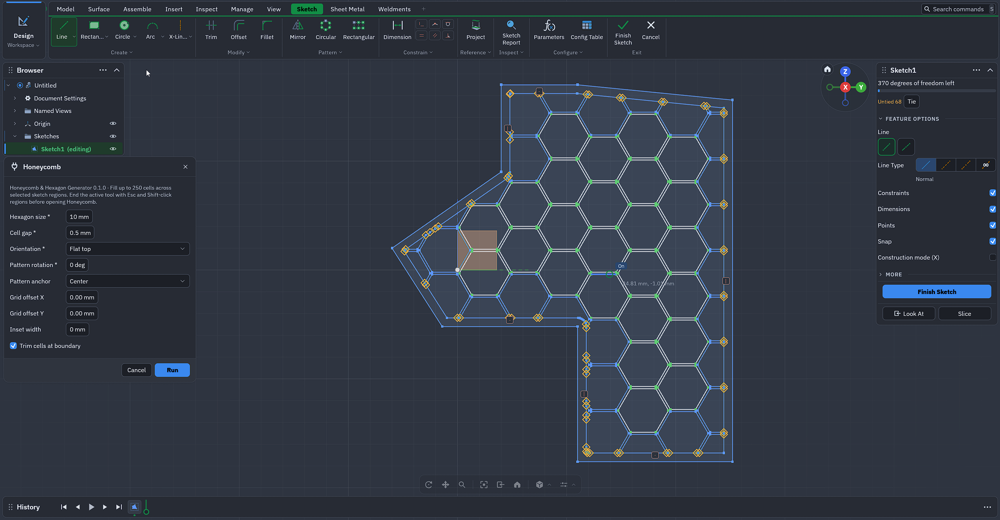

# SolidCraft Honeycomb & Hexagon Generator

Fill one or more selected regions in an open SolidCraft sketch with a continuous honeycomb grid. Choose the hexagon size, spacing, orientation, rotation, and grid anchor. Keep whole cells, trim them at the outline, or leave a border with an inset.



*Honeycomb settings and a generated pattern in a SolidCraft sketch.*

## Compatibility

Targets [SolidCraft Desktop v0.41.0](https://github.com/tangency-labs/solidcraft/releases/tag/v0.41.0).

## Install

1. On GitHub, open **Releases** and download `solidcraft-honeycomb.zip`.
2. In SolidCraft Desktop, go to **Preferences → Plugins → Install plugin** and select the ZIP.
3. Review the requested command permissions and approve the package when SolidCraft prompts you.

For a development build, open a successful **Build SolidCraft plugin** run under **Actions**. Download the `solidcraft-honeycomb-plugin` artifact and extract `solidcraft-honeycomb.zip` from it.

## Quick start

1. Open a sketch, draw a closed outline with straight lines, and press **Esc** to exit the sketch tool.
2. For multiple regions, **Shift-click** the regions you want to fill, or select all boundary lines around each separate outline. The plugin detects a single closed outline automatically.
3. Open **Plugins → Honeycomb**, leave the default settings in place, and select **Run**.

The plugin adds the pattern to your open sketch and keeps the original outline. Selected regions share one grid even when they are separated by a gap. You can undo the entire generation in one step. To extrude the pattern, finish the sketch and use SolidCraft's **Extrude** command.

## Pattern settings

| Setting | What it does |
| --- | --- |
| **Hexagon size** | Distance across opposite flats, from 0.2 to 500 mm. |
| **Cell gap** | Distance between cells, from 0.05 mm to four times the hexagon size. |
| **Orientation** and **Pattern rotation** | Choose the direction of the hexagons and rotate the grid from −180° to 180°. |
| **Pattern anchor** | Align the grid to a point, a corner, or the center. For **Selected sketch point**, select exactly one point in the active sketch before opening Honeycomb. At zero offset, a corner anchor aligns a hexagon to both corresponding sides of the fill bounds when the shape allows it. |
| **Grid offset X** and **Grid offset Y** | Shift the grid right or up from the anchor in sketch coordinates, from 0 to 2,500 mm per axis. |
| **Trim cells at boundary** | Include clipped cells where the grid crosses the fill boundary. Turn it off to keep only complete hexagons. |
| **Inset width** | Use 0 mm to fill to the original boundary. Use at least 0.01 mm to create an inset outline and fill within it. Corner anchors then use the inset bounds. |

Use up to 250 cells per run. The plugin accepts closed straight-edged boundaries, including concave outlines, from one sketch. See [limitations and desktop verification](docs/LIMITATIONS.md) for more detail.

## Edit an existing pattern

Open **Solid → Modify → Change Parameters** and edit the size and gap for the pattern you want to change, for example `honeycomb_2_size` and `honeycomb_2_gap`.

Complete cells resize and shift according to their original grid positions. The cell count, clipped edges, and inset outline stay fixed. To recalculate how the pattern fits the boundary, remove the previous pattern and generate it again.

## Build from source

The plugin uses SolidCraft's experimental `craft:plugin@0.1.0` interface with the `commands@0.1` capability.

GitHub Actions runs the locked Rust tests, builds the WebAssembly module, checks the resulting component against the plugin WIT contract, and uploads the installable ZIP. A matching version tag, such as `v0.1.0`, also publishes the ZIP as a GitHub Release asset after those checks pass.

For a local build, install Rust stable with rustup and use Bash with `zip`, or Git Bash with Windows PowerShell. Run these commands from the repository root.

```sh
rustup target add wasm32-unknown-unknown
cargo test --locked
cargo build --locked --release --target wasm32-unknown-unknown
cargo install wasm-tools --version 1.263.0 --locked
bash scripts/package.sh
```

The packaging script writes `dist/solidcraft-honeycomb.zip`. Use the GitHub Actions package when distributing builds. CI remaps local build paths and checks the packaged component for machine-specific paths.

## License

MIT. See [LICENSE](LICENSE).
